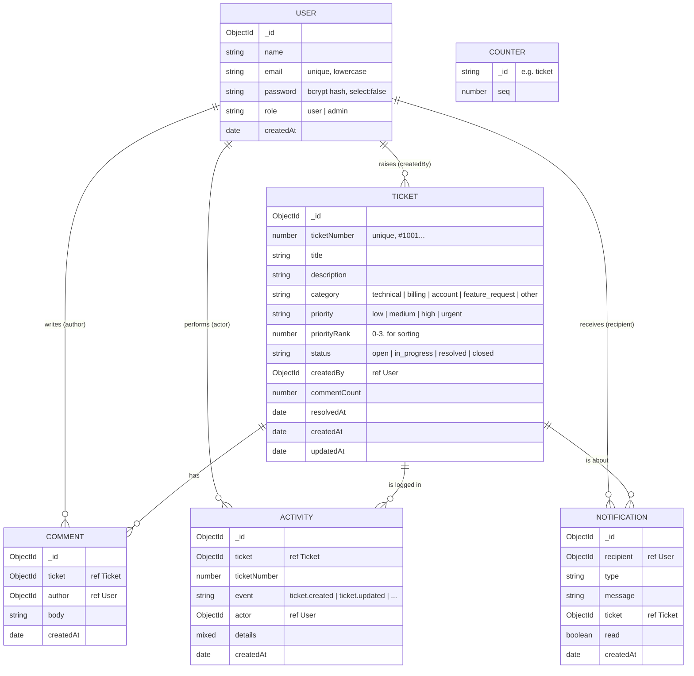

# Database Design

MongoDB, modelled with Mongoose. Six collections:

## Design decisions

**References, not embedding, for comments.** Comments could be embedded inside the ticket document, but a busy ticket would keep growing towards MongoDB's 16 MB document limit, and the list screen would load every comment just to show a title. Comments live in their own collection (indexed by `ticket`), and the ticket keeps a denormalised `commentCount` so the list can show "💬 3" without a join.

**Human-friendly ticket numbers.** `_id` is an ObjectId, which is not something a customer can read out on the phone. A `counters` collection hands out `#1001, #1002, …` with an atomic `findOneAndUpdate({ $inc: { seq: 1 } })`, so two tickets created at the same moment can never get the same number.

**`priorityRank` for sorting.** Sorting the `priority` string would give `high, low, medium, urgent` (alphabetical). A numeric `priorityRank` (0–3) is kept in sync by a `pre('save')` hook, so "sort by priority" really means low → urgent.

**`resolvedAt` is derived.** The same hook stamps `resolvedAt` when a ticket becomes `resolved` and clears it if the ticket is reopened, so the API never has to remember to do it.

**Passwords.** Stored as bcrypt hashes (10 rounds). The field has `select: false`, so it is never returned by a query unless the login code explicitly asks for it, and the API serialiser never includes it anyway.

**Activity is an append-only audit log.** Rows are written only by the event handlers, never edited, and are kept when a ticket is deleted (that is why `ticketNumber` is copied onto each row — the log stays readable). `details` is a flexible object because each event carries different data (`{ from, to }` for a status change, changed fields for an edit, an excerpt for a comment).

**Deleting a ticket** removes its comments and notifications (they make no sense without it) but keeps its activity rows.

## Indexes

| Collection | Index | Serves |
|---|---|---|
| users | `{ email: 1 }` unique | login, duplicate-email check |
| tickets | `{ ticketNumber: 1 }` unique | ticket numbers |
| tickets | `{ createdBy: 1, createdAt: -1 }` | "My tickets", newest first |
| tickets | `{ status: 1, priority: 1, createdAt: -1 }` | admin filters |
| comments | `{ ticket: 1 }` | comment thread |
| activities | `{ ticket: 1, createdAt: -1 }` | ticket timeline |
| activities | `{ createdAt: -1 }` | dashboard "recent activity" |
| notifications | `{ recipient: 1, read: 1, createdAt: -1 }` | bell dropdown + unread count |

Search uses a case-insensitive regex on title/description (user input is escaped first). That is fine at assignment scale; for large data the next step would be a MongoDB text index or Atlas Search.

## Access rules enforced in the API (not the database)

- A user can only see, edit, delete and comment on tickets they created. Asking for another user's ticket returns **404**, so ticket IDs cannot be probed.
- Users may edit or delete a ticket only while it is `open`; once support starts working on it, it is locked for them.
- Only admins can change `status`. Admins can see and manage every ticket.
- Nobody can comment on a `closed` ticket.
